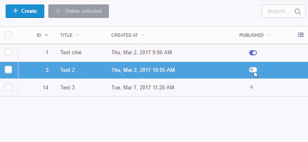
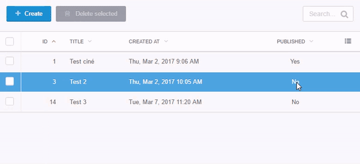
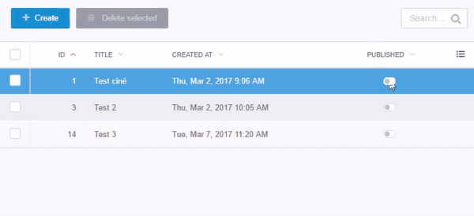

# ListSwitchPlus

OctoberCMS plugin that adds a toggleable switch as a column type to backend lists.
Clicking the switch inverts a boolean field of the record and refreshes the list.

A standalone replacement for [inetis/listswitch](https://github.com/inetis-ch/oc-ListSwitch-plugin) with:

- a Bootstrap switch instead of ✓/✗ icons (see [Appearance](#appearance));
- the `inverse` option — the switch position can be the opposite of the field value
  (handy for fields like `is_hidden`: the switch is "on" when the record is visible);
- signed toggle requests — a backend user cannot invert an arbitrary field of an arbitrary model;
- a hook to restrict which records can be toggled;
- support for relation lists inside forms (RelationController).

The column type `inetis-list-switch` and the AJAX handler names are kept, so existing
`columns.yaml` files work without changes: by default the switch is "on" when the field is true,
just like ✓ in the original.

## Requirements

- OctoberCMS 3.x / 4.x (the backend must include Bootstrap 5, see [Appearance](#appearance))
- PHP 8.0+

## Installation

Copy the plugin to `plugins/konvertagency/listswitchplus`, or add it via git subtree:

```bash
git subtree add --prefix=plugins/konvertagency/listswitchplus https://github.com/point111/october-listswitchplus.git main --squash
```

or via Composer (VCS repository):

```json
"repositories": [
    { "type": "vcs", "url": "https://github.com/point111/october-listswitchplus" }
],
"require": {
    "konvertagency/listswitchplus-plugin": "dev-main"
}
```

Then run `php artisan october:migrate`.

### Migrating from inetis/listswitch

Disable or remove `Inetis.ListSwitch`. **Do not run both plugins at the same time**: they register
the same column type, and OctoberCMS uses the plugin that comes first in load order
(Inetis), so this plugin would be ignored.

Existing columns need no changes: without `inverse` the switch follows the field value
(on = true), as ✓/✗ did. Add `inverse: true` only where the switch should show the opposite.

## Usage

Set the `type` of the column to `inetis-list-switch`:

```yaml
is_hidden:
    label: 'Published'
    type: inetis-list-switch

    # Switch position is the opposite of the field value (default: false)
    inverse: true

    # Show the Bootstrap switch; false shows Yes/No text instead (default: true)
    icon: true

    # Title displayed on hover
    titleTrue: 'Publish item'     # default: 'konvertagency.listswitchplus::lang.listswitch.title_true'
    titleFalse: 'Unpublish item'  # default: 'konvertagency.listswitchplus::lang.listswitch.title_false'

    # Text displayed on the button when icon: false
    textTrue: 'Hidden'            # default: 'konvertagency.listswitchplus::lang.listswitch.text_true'
    textFalse: 'Published'        # default: 'konvertagency.listswitchplus::lang.listswitch.text_false'

    # AJAX handler (default: onSwitchInetisListField)
    request: onSwitchInetisListField
```

`titleTrue` / `textTrue` are used when the **field value** is true, regardless of `inverse`.

| Field value | `inverse: false` (default) | `inverse: true` |
|---|---|---|
| `true`  | on  | off |
| `false` | off | on  |

The column is made non-clickable automatically, so clicking the switch does not open the record.

## Appearance

The original ✓/✗ icons are replaced with the standard Bootstrap 5
[switch](https://getbootstrap.com/docs/5.3/forms/checks-radios/#switches):

```html
<div class="form-check form-switch"><input class="form-check-input" type="checkbox" checked></div>
```

The plugin ships no CSS of its own. The switch is styled by the Bootstrap that is bundled with
the OctoberCMS backend (`modules/system/assets/vendor/bootstrap/bootstrap.css`, imported by
`modules/system/assets/css/main.css`; Bootstrap 5.3 in OctoberCMS 4.x). Its colors therefore follow
the backend theme. This is why OctoberCMS 3.x or newer is required: older versions ship Bootstrap 3,
where the markup renders as a plain checkbox.

To restyle the switch, override `.form-switch .form-check-input` in your backend CSS.

## Security

Each switch carries an HMAC-SHA256 signature of `model|id|field`, made with the application key
(`APP_KEY`). The handler rejects requests with a missing or wrong signature, so the model class,
record id and field name cannot be substituted in the request.

### Restricting records: `listSwitchFindRecord`

By default the record is loaded with `$modelClass::findOrFail($id)`. If the backend controller
has a `listSwitchFindRecord` method, it is used instead. Throw an exception there to deny the toggle:

```php
public function listSwitchFindRecord(string $modelClass, $id)
{
    $record = $modelClass::findOrFail($id);

    if ($record->is_locked) {
        throw new \ApplicationException('This record cannot be changed.');
    }

    return $record;
}
```

## Demo

### Default behavior



### Behavior with `icon: false`



### With custom titles



## Credits

Based on [inetis/listswitch](https://github.com/inetis-ch/oc-ListSwitch-plugin) by [inetis](https://inetis.ch),
released under the MIT License. See [LICENSE](LICENSE).
